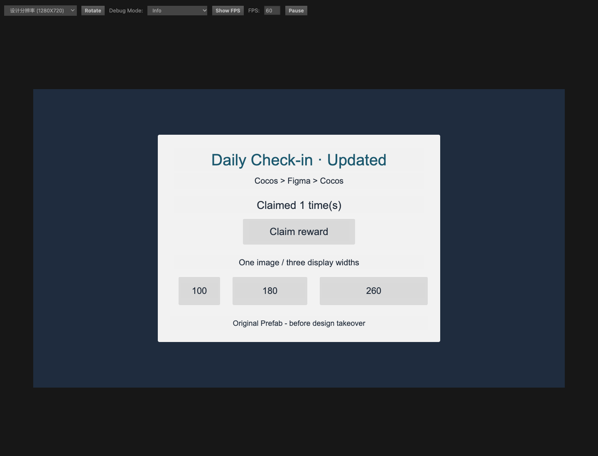

# DoomUI Sandbox

Cocos Creator 3.8.6 的公开演示与验收工程。场景展示 Figma 同步后的双 Prefab、脚本保留和九宫格复用，无需连接 Figma 即可运行。

## 运行示例

1. 用 Creator 3.8.6 打开本目录，等待资源导入和脚本编译。
2. 打开 `assets/ArticleDemo.scene`，点击浏览器预览。
3. 确认标题为 `Daily Check-in · Updated`，点击 `Claim reward`，奖励文字应变为 `Claimed 1 time(s)`，继续点击会累计次数。

| 路径 | 用途 |
|---|---|
| `assets/legacy/UI_ArticleDemo.prefab` | 创建 Figma 起点之前的原始视觉样例 |
| `assets/article_ui/prefabs/view/UI_ArticleDemo.prefab` | 外层逻辑 Prefab，挂载 `ArticleDemoController` |
| `assets/article_ui/prefabs/view/figma/UI_ArticleDemo.root.prefab` | 更新标题后的视觉 Prefab，作为名为 `root` 的子实例嵌套 |
| `assets/ArticleDemoController.ts` | 原生 Button 点击与奖励文字更新 |

示例复用 Creator 3.8.6 内置的默认面板和按钮 SpriteFrame，不复制引擎图片。三个九宫格面板共用同一张 40 × 40 原图，四边切片均为 12，显示尺寸分别为 100 × 70、180 × 70、260 × 70。

## 重新走 Figma 同步流程

在仓库根运行 `just install`、`just check`、`just sandbox-link`，然后在 Creator 打开 `扩展 → DoomUI → Figma Sync`。Figma Desktop 导入仓库的 `cocos-sync/manifest.json`，按[开发指南](../docs/development.md)完成本机配对。

1. 在自己的 Figma 文件中，从 `db://assets/legacy/UI_ArticleDemo.prefab` 创建 UI Frame 起点。
2. 在 Creator 中另建并配置 Asset Bundle，例如 `assets/roundtrip`，输出根填写 `db://assets/roundtrip`。
3. 从 Figma 推送该 Frame，检查 Preview 后执行首次 Apply；在新逻辑 Prefab 根挂载 `ArticleDemoController` 并保存。
4. 在 Figma 修改标题文字，再次 Push / Preview / Apply。记录并比较逻辑 Prefab 哈希、视觉 UUID 和按钮行为，验证保存、关闭重开后仍能使用。

仓库中的 `article_ui` 是离线成果 Fixture，不包含私有 Figma 文件的同步映射。直接对该路径首次 Apply 会触发非插件资产冲突；请使用独立的 `roundtrip` Bundle。测试输出与 `settings/v2/packages/figma-sync.json` 保留本机，不提交私有设计关联。

## 验收范围

该 Fixture 最初使用 DoomUI 26.42.29 完成两次真实 Push / Apply，验证了逻辑文件哈希、视觉 UUID、保存重开与按钮点击。历史结果及迁入后复验分别记录在[验收记录](../docs/acceptance.md)。

示例未内置第三方字体。重新同步时会有 9 条 `FONT_UNMAPPED` 警告，继续使用系统字体；这是字体回退示例，不代表目标设备排版已验收。正式项目应配置有权分发的字体资产。四态按钮、动态列表、真机和正式构建需分别验收。

在仓库根运行 `just sandbox-check` 可检查 Meta、UUID、脚本和跨 Prefab 资源引用；它不能代替 Creator 的真实导入与运行。
